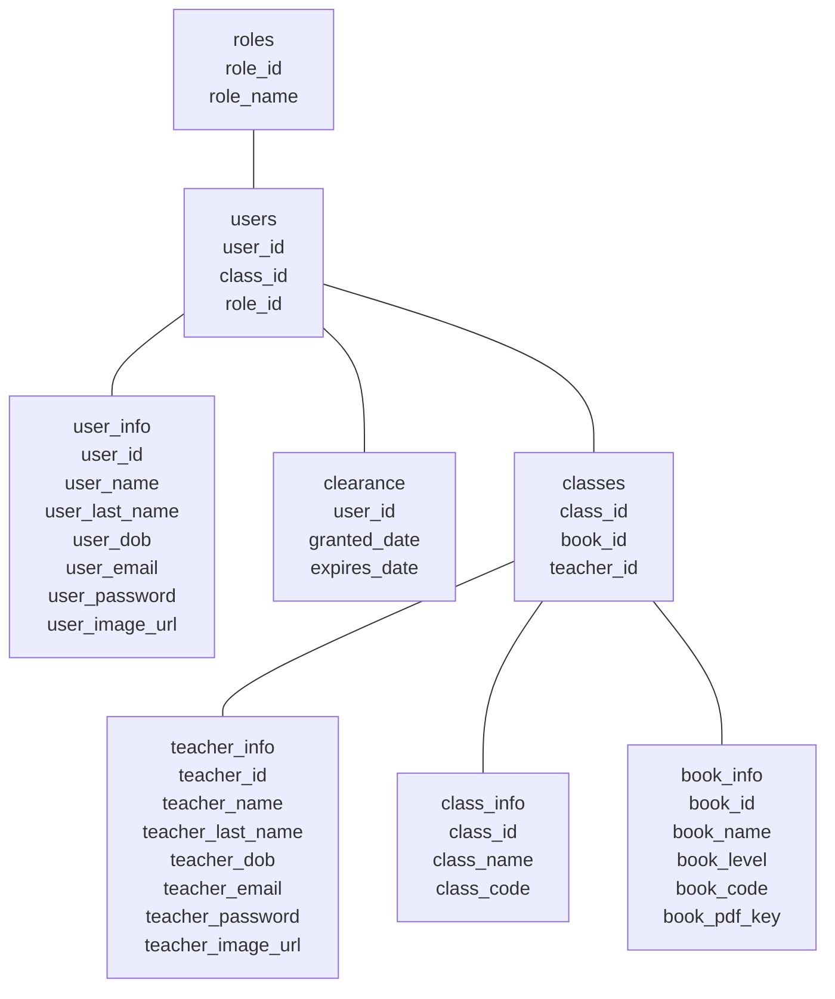

# Classroom Backend Project

## Project Overview

This project is an English classroom website built with an MVC structure and server-rendered pages. It will provide students with learning materials and allow teachers and administrators to manage classroom information.

The website is planned to support three roles:

- **Students:** View books, posts, and general information.
- **Teachers:** View learning materials and update students’ names.
- **Administrators:** Manage website information and features.

Each student belongs to one class. Each class has one teacher, and a teacher can teach multiple classes. Each class is associated with one book.

The available books cover levels A1, A2, B1, and B2. C1 and C2 books are planned for later. Users will be able to change their profile photos and read books on the website.

## Technologies

- **Backend:** Node.js and Express
- **Views:** EJS
- **Styling:** Tailwind CSS
- **Database:** PostgreSQL, accessed with `pg` and SQL
- **File storage:** Supabase Storage for profile photos and book PDFs
- **Authentication:** Sessions and password hashing
- **Deployment:** Render

PostgreSQL stores book and user records, including paths to files in Supabase Storage.

## Current Project Layout

```text
Backend Sample - MVC/
├── app/
│   └── src/
│       ├── controllers/
│       ├── db/
│       ├── middleware/
│       ├── models/
│       ├── routes/
│       ├── style/
│       ├── views/
│       └── app.js
├── public/
│   └── css/
├── server.js
├── package.json
├── package-lock.json
├── render.yaml
└── README.md
```

Some folders are currently empty and will be developed as the project progresses.

## Database Relationships

The diagram below follows the original design; its fields and relationships have not yet been verified against the current database.



## Website

[Open the project on Render](https://backend-final-project-bcl3.onrender.com/)
